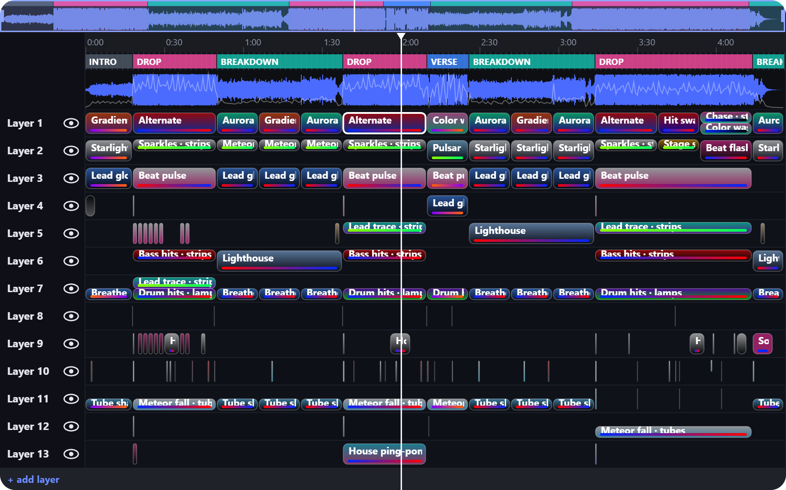
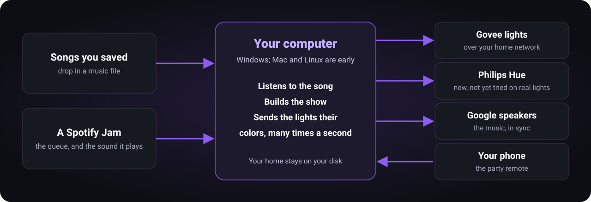

  

  
  
  
  
  

  <b>Put on any song and your lights play it the way a lighting crew would.</b> 
  It finds every beat, build-up and drop by itself. No programming, no DMX rig, no light-show skills.

  
  
  
  

  Or run it from source with Python 3.11+: <code>pip install -r requirements.txt</code>, then <code>python -m lightshow studio</code> (<a href="docs/GUIDE.md#setup">details</a>).

> **Where it stands.** Windows is the fully working system, proven on Govee lights and Google speakers. The Mac and Linux apps build, but they haven't been tried on real machines yet, and capturing Spotify's audio, which Jam mode runs on, isn't done there. The Mac app is unsigned, so right-click it and choose Open. Philips Hue is built and tested against a simulated bridge, but has never run on real Hue lights.

---

## Why it exists

Smart lights already have a music mode. It listens through a microphone and reacts to whatever just happened, so a drop gets the same flicker as everything before it.

A lighting crew works differently. They know the song, so they hold back in the verse, build with the snare and hit everything the moment the drop lands.

> **What if your lights knew the song before they played it?**

Light Show Studio studies each song first, then plays your lights from a show designed around it.

## Every song becomes a show

  

- **It takes the song apart.** Tempo and beat grid, where the verses, build-ups, drops and breakdowns are, what the drums and bass are doing, and what genre it is.
- **It lights the energy, not just the beat.** Chill parts only swell slowly. Builds throw snare hits around the room, and drops hit with everything.
- **It colors each song.** Two colors from the album cover, or your party's colors, and you can change them for any song.
- **It was taught by hand.** The section model is trained on 140 songs reviewed section by section, so it labels songs the way a person would. Review enough of your own and it trains one that knows your music.

## Your whole home is the stage

  

Draw your home in a minute: add rooms of any shape, then pin each light where it really stands. Because the studio knows where everything is, effects travel through the space instead of just blinking in place.

## Your phone runs the party

  

Scan a QR code and your phone is the remote. Add it to your home screen and it opens like an app.

| | What you get |
|---|---|
| 🎵&nbsp;**Now&nbsp;Playing** | Skip and pause, on a screen that glows in the song's colors |
| 🎨&nbsp;**Up&nbsp;next** | Every queued song with the two colors it will play in. Tap one to change it, or set its vibe and genre |
| 🎚️&nbsp;**Party&nbsp;level** | One slider calms the whole home down or lets it go all out |
| 🚪&nbsp;**Rooms** | Switch any room in or out of the party |
| 🎭&nbsp;**Party&nbsp;modes** | Big buttons for the moments the party stops for: an announcement, a toast, cake. Name your own and pick how the music and lights respond |

## Spotify picks the music, the lights keep up

  

Run a Spotify Jam and let everyone add songs all night. **Jam mode** follows along, so each track gets its own show.

- **The room runs a little behind Spotify.** Spotify plays on your computer, and the studio relays that audio to your Google speakers. That gap lets it know what's coming before anyone hears it.
- **It learns ahead.** With the optional learn-ahead set up, each queued song is studied before it plays and the room is only seconds behind. It fetches a temporary copy to study, then deletes it ([details, including YouTube's terms](docs/GUIDE.md#jam-mode-someone-else-picks-the-music)). Without it, the room runs about 90 seconds behind instead.
- **Spotify's audio is never saved.** It only exists in a rolling buffer in memory.
- **What you need.** Spotify Premium, a free Spotify developer app (the studio walks you through it), and Windows for now.

## Built for you, and still yours to change

  

Every show is built automatically, and every part of it can be changed. Open the studio, drop in a song, press **Auto-build show**, then move, swap or recolor anything on the timeline.

| | Also included |
|---|---|
| ✅&nbsp;**Guided&nbsp;setup** | **Get started** finds your lights and speakers, helps you draw the map and gives you a QR code for your phone |
| 🧠&nbsp;**Optional&nbsp;AI&nbsp;models** | One click installs models for sections, drums and bass, beats and genre, built for your NVIDIA, AMD, Intel Arc or Apple Silicon graphics. Without them, the built-in analysis still finds the beats, sections and drops |
| 🔔&nbsp;**Doorbell&nbsp;add-on** | A Reolink video doorbell rings a cue: the music dips and the show you picked plays |
| 💡&nbsp;**Bulb&nbsp;Shows&nbsp;add-on** | Looping shows on Govee bulbs, with a sound on a speaker |
| 🏠&nbsp;**Home&nbsp;Assistant&nbsp;add-on** | Tells Home Assistant when the show has your lights, so its automations leave them alone |

## It runs on your computer

  

- **No cloud of ours.** No account to make and nothing to subscribe to. Your lights, rooms and map stay in one folder on your computer.
- **Fast enough for a drop.** Lights are driven directly over your home network many times a second, with no Govee account or API key.

## Get started in 4 steps

1. **Download** Light Show Studio for your computer (buttons at the top).
2. **Open it and follow Get started** in Settings. Turn on **LAN Control** for each Govee light in the Govee Home app (Hue: set up an Entertainment area and press the bridge's button once). Then name your rooms, draw the map and let it find your speakers.
3. **Connect Spotify** if you want Jam mode.
4. **Open the Party Hub on your phone.** Scan the QR code in Settings, add it to your home screen, and start the party.

## Learn more

Everything in detail is in **[the full guide](docs/GUIDE.md)**:

- [Setting up your home](docs/GUIDE.md#set-up-your-home): lights, rooms and the map
- [Philips Hue](docs/GUIDE.md#philips-hue)
- [Jam mode](docs/GUIDE.md#jam-mode-someone-else-picks-the-music): Spotify, learning songs ahead, casting and sync
- [The Party Hub](docs/GUIDE.md#party-hub-the-jam-from-your-phone), [rooms](docs/GUIDE.md#rooms) and [cues](docs/GUIDE.md#cues-the-doorbell-shot-oclock)
- [The studio](docs/GUIDE.md#studio-build-a-show-on-a-saved-song): building and editing shows, every setting
- [AI models](docs/GUIDE.md#ai-models) and [add-ons](docs/GUIDE.md#add-ons)
- Troubleshooting: [lights on Wi-Fi](docs/GUIDE.md#the-lights-frame-rate-follows-the-wi-fi), [giving the lights priority](docs/GUIDE.md#priority-for-the-lights-on-wi-fi), [segment counts](docs/GUIDE.md#segment-counts)

---

The floor plan, rooms and party screens shown here use made-up sample data. The lighting patterns in the graphics illustrate the idea; they aren't a recording of a real show.
