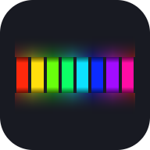
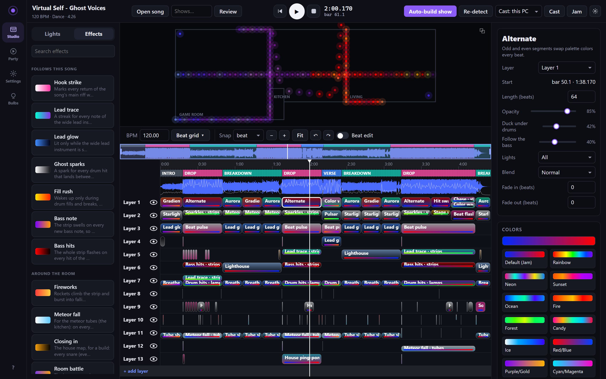
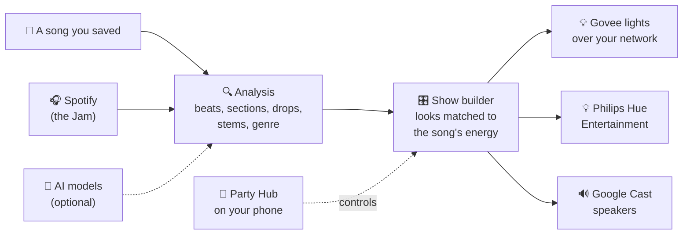
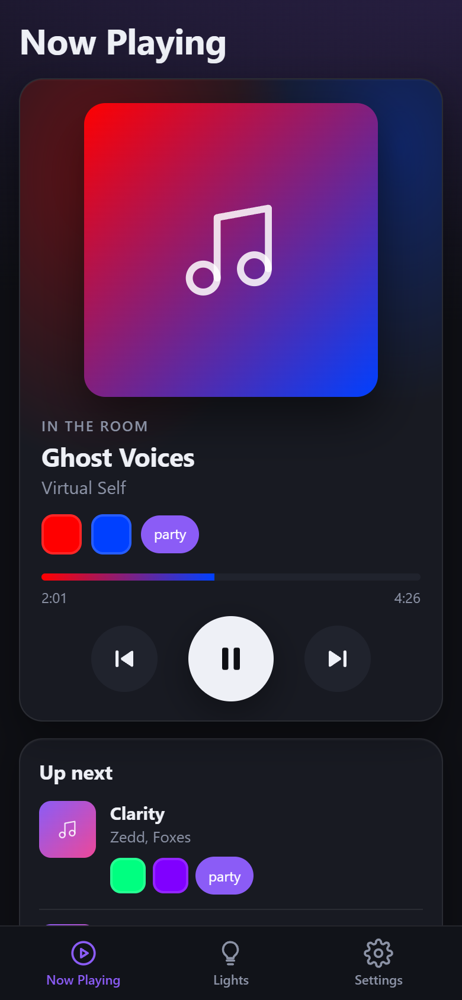
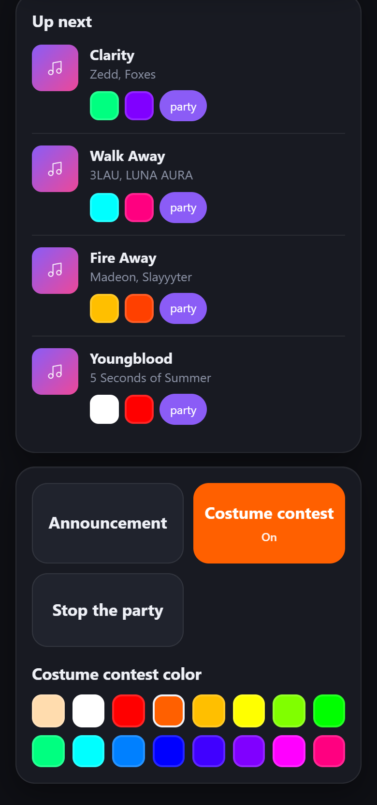
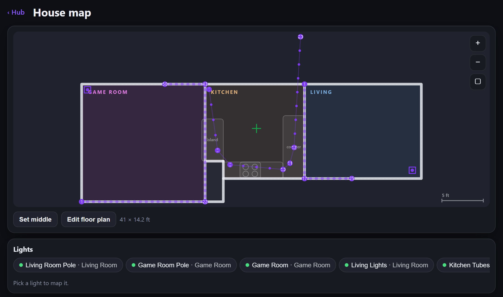
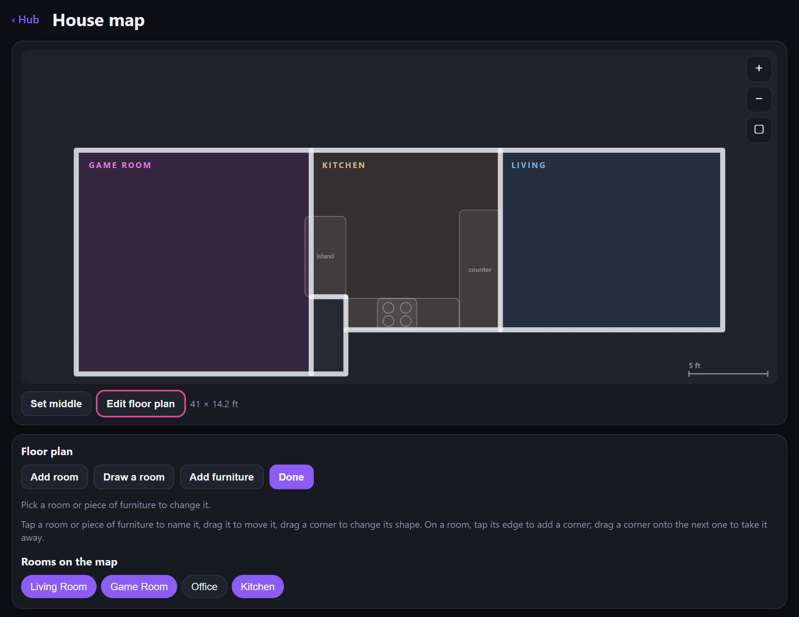
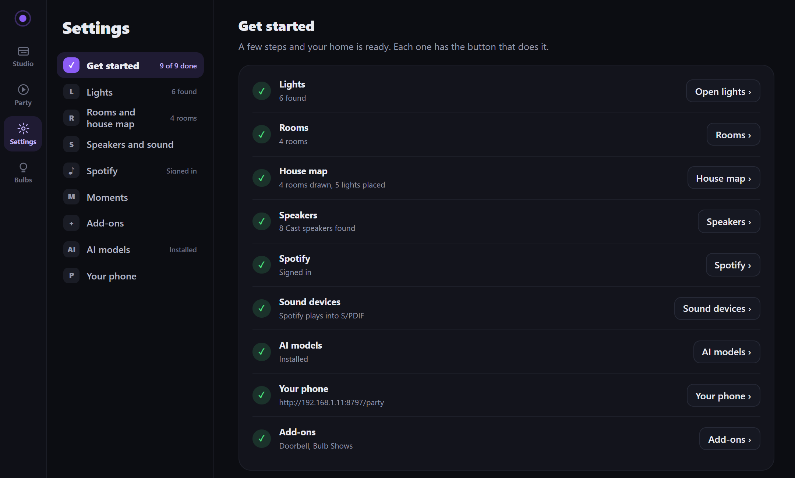
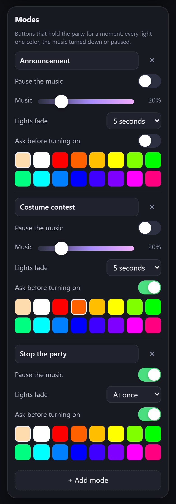
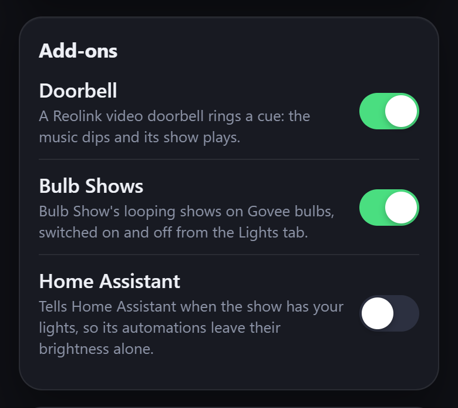

  

<h1 align="center">Light Show Studio</h1>

<h3 align="center">Turn your existing smart lights into a rave that syncs itself to every song.</h3>

  
  
  
  

  Or run it from source with Python 3.11+: <code>pip install -r requirements.txt</code>, then <code>python -m lightshow studio</code> (<a href="docs/GUIDE.md#setup">details</a>).

---

Put on any song and your house becomes a concert. Light Show Studio listens to the music, finds every
beat, build-up and drop, and plays your **Govee** and **Philips Hue** lights like a lighting crew
would: calm glows in the verses, sweeps across the room in the build, everything hitting at once
when the drop lands. The music plays on your **Google speakers**, perfectly in time, and your phone
runs the party. No programming, no DMX rig, no light-show skills needed.

  
   
  The studio: your house with every light live on top, the song's sections and drops, and the show laid out in layers. Every show is built for you, and every part of it can be changed by hand.

## How it works

Every song is analyzed first: its tempo and beat grid, where the intro, verses, build-ups, drops and
breakdowns are, what the drums, bass and vocals are doing, and what genre it is. The show builder
then designs a show around it, matched to the energy of each moment and colored from the song (or
your party's colors). With **Jam mode**, Spotify picks the music and the studio learns each song
ahead of time, so every track in the playlist gets a full show from its first beat. Lights are
driven over your home network many times a second, and the music reaches your speakers in sync.

## Highlights

### 📱 The Party Hub: your phone is the remote

  
  &nbsp;&nbsp;
  

Scan a QR code and your phone runs the night. **Now Playing** glows in the song's colors (its
album cover's, or your party's), with skip and pause. **Up next** shows every queued song with the
two colors it will play in: tap one to change it, or set its vibe and genre. A **Party** slider
calms the whole house down or lets it go all out, and each room can be switched in or out of the
party. Add it to your home screen and it opens like an app.

<!-- A screenshot of the desktop Party view can go here once it ships. -->

### 🗺️ A map of your house

  
  

Draw your home in a minute: add rooms (any shape, corner by corner), drop in an island or a couch,
then pin each light where it really stands. Because the studio knows where everything is, effects
travel through the room for real: sweeps cross the house, a build closes in around you, and the
rooms battle each other on the beat.

### ✅ Setup that walks you through it

  

The first time you open it, **Settings** starts on **Get started**: a few steps and your home is
ready, each with the button that does it. It finds your lights and speakers on the network, helps
you name your rooms and draw the map, signs in to Spotify, picks your sound devices from a list,
installs the AI models in one click, and gives you a QR code for your phone. Every setting for
your home lives there afterward, in one place.

### 🎭 Party modes, made by you

Big buttons for the moments the party stops for. **Announcement** turns the music down and every
light one warm color so people can hear you; **Stop the party** pauses the music. Make your own for
anything (a costume contest, cake time, a toast): give it a name, choose whether the music goes
down or pauses, how fast the lights fade, the color they all turn, and whether it asks twice before
it starts. Tap it again and the party picks up where it left off.

 

### 🧩 Add-ons

Extras for some homes, off until you switch them on:

- **Doorbell**: a Reolink video doorbell rings a cue. The music dips and the show you picked plays.
- **Bulb Shows**: looping shows on Govee bulbs, with a sound on a speaker.
- **Home Assistant**: tells Home Assistant when the show has your lights, so its automations
  leave them alone.

 

### 🧠 AI models on almost any computer

Optional AI models listen to each song in depth: where its sections start (SongFormer), the drums,
bass and vocals on their own (Demucs), its beats (Beat This), every drum hit (ADTOF) and its genre
(MAEST). The studio installs them with one click, built for your machine:

| Your computer | Runs on |
|---|---|
| NVIDIA graphics card (Windows, Linux) | CUDA |
| AMD graphics card on Linux | ROCm |
| AMD or Intel Arc card on Windows | DirectML |
| Mac with Apple Silicon | Metal |
| Anything else | The CPU (slower) |

No models? The built-in analysis still finds the beats, sections and drops.

### 🎯 A section model trained by hand

Knowing exactly where the drop hits is what makes a light show feel right. The studio ships with a
section model trained on **140 songs reviewed by hand**, section by section, so it labels intros,
verses, build-ups, drops, breakdowns and outros the way a person would. Review your own songs and, once
you've reviewed more than it was trained on, it trains one that knows your music.

## Get started in 4 steps

1. **Download** Light Show Studio for your computer (buttons above).
2. **Open it and follow Get started** (in Settings). Turn on **LAN Control** for each Govee light in the
   Govee Home app (Hue: set up an Entertainment area and press the bridge's button once). Then
   name your rooms, draw the map and let it find your speakers.
3. **Connect Spotify.** You need Spotify Premium and a free Spotify developer app; the studio walks
   you through making one, step by step.
4. **Open the Party Hub on your phone.** Scan the QR code in Settings (Your phone), add it to your home screen,
   and start the party.

Prefer to build a show by hand? Drop any song into the studio and press **Auto-build show**, then
change whatever you like.

## Learn more

Everything in detail is in **[the full guide](docs/GUIDE.md)**:

- [Setting up your home](docs/GUIDE.md#set-up-your-home): lights, rooms and the house map
- [Philips Hue](docs/GUIDE.md#philips-hue) (new, tested so far against a simulated bridge)
- [Jam mode](docs/GUIDE.md#jam-mode-someone-else-picks-the-music): Spotify, learning songs ahead, casting and sync
- [The Party Hub](docs/GUIDE.md#party-hub-the-jam-from-your-phone), [rooms](docs/GUIDE.md#rooms) and [cues](docs/GUIDE.md#cues-the-doorbell-shot-oclock)
- [The studio](docs/GUIDE.md#studio-build-a-show-on-a-saved-song): building and editing shows, every setting
- [AI models](docs/GUIDE.md#ai-models): what each one does and how to install them
- [Add-ons](docs/GUIDE.md#add-ons) and [the doorbell](docs/GUIDE.md#the-doorbell-rings-a-cue)
- Troubleshooting: [lights on Wi-Fi](docs/GUIDE.md#the-lights-frame-rate-follows-the-wi-fi), [giving the lights priority](docs/GUIDE.md#priority-for-the-lights-on-wi-fi), [segment counts](docs/GUIDE.md#segment-counts)
